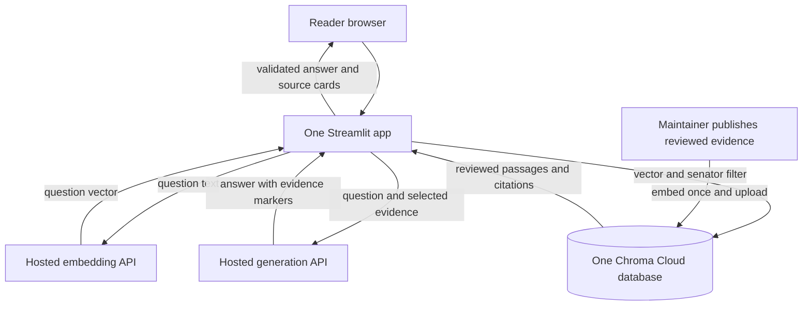

# SEN’TO deployment plan

Prepared 26 November 2026 against repository commit `f9d877a`.

**Recommendation:** Keep one Streamlit app on Streamlit Community Cloud, use one persistent Chroma Cloud database, and call hosted OpenAI APIs for embeddings and generation. Keep one active evidence collection shared by the senator chats, with mandatory senator filters. This preserves the current Python services and Chroma record shape and removes the laptop from the serving path.

This is a plan for later implementation. Only this planning document was created. Application code, source records, generated chunks, and indexes were not changed. No authenticated model requests, provisioning, deployment, or paid operations were performed. The protected `.env` was not read, written, sourced, or otherwise accessed. No credential values or deployed app settings were inspected.

The first release is ready when someone can open the app from another device while the developer’s laptop is off, ask a supported question about a selected senator, inspect the correct source and locator, and receive an explicit abstention for an unsupported question. Restarting the app must preserve its evidence index. Correct claim support needs human review as well as automated citation checks.

## 1 What exists and what blocks deployment

The running path is already connected:

`app.py → frontend/pages/chat_page.py → frontend/api.py → backend/chatbot_service.py → ai/rag_factory.py → ai/pipeline.py`

All repository paths below are relative to the project root containing this document’s parent `docs/` folder.

| Area | Observed repository state | Deployment consequence |
| --- | --- | --- |
| Streamlit app | [app.py](../app.py) provides Home, Chat, and Compare. Chat calls the real RAG service. | Keep this app and its entry point. A separate web API is unnecessary for this demo. |
| Senator histories | [chat_page.py](../frontend/pages/chat_page.py) keeps `histories[senator_id]` in Streamlit session state, capped at 40 messages per chat. | Histories are already separate within a session. They may reset on refresh, disconnect, or app restart. |
| Conversation memory | [generation.py](../ai/generation.py) sends the current question and evidence, without prior turns. | A displayed transcript does not mean the model understands references to an earlier answer. |
| Topic switching | No cross-senator name detector or switch action exists. | Add the respectful handoff required by the owner before presenting the chats as strictly scoped. |
| Research inputs | `data/senator_records/` contains 24 Markdown profiles; the directory JSON has 24 entries. | These are research inputs and directory entries, not proof of current roster or complete coverage. |
| Ingestion | [senator_markdown.py](../ai/senator_markdown.py) handles the supplied claim schema, frontmatter, claim IDs, and bibliography IDs. It does not fetch cited URLs. | Parsing is implemented; original-source review is still a separate job. |
| Processed evidence | The existing `data/corpus/processed/senator_chunks.jsonl` has 954 chunks: 200 marked `verified`, 754 `candidate_source`. The 200 span 19 senator IDs. | These are importer eligibility counts. A `VERIFIED` input label plus complete metadata is not independent factual verification. |
| Original-document route | `data/corpus/manifest.json` is an empty list and `originals/` contains only its placeholder. | This route is unused. An empty manifest does not prevent using reviewed senator Markdown through the separate importer. |
| Vector index | No `data/corpus/processed/chroma/` index is present in this checkout. | Ingestion has not produced a searchable vector database. The default chat currently abstains without generation. |
| Embeddings | [embeddings.py](../ai/embeddings.py) implements only Ollama; both the factory and index tool construct it directly. Default URL: `http://127.0.0.1:11434`. | Selecting hosted generation alone still leaves a local embedding dependency for indexing and every search. |
| Storage connection | [vector_store.py](../ai/vector_store.py) constructs `chromadb.PersistentClient`. The factory first checks whether its local folder exists. | Cloud retrieval needs a remote client and must bypass this local-folder gate. |
| Retrieval isolation | Chroma filters by senator and verified status. [pipeline.py](../ai/pipeline.py) independently checks senator association and provenance before generation. | Preserve both checks when adding remote storage. One database can safely serve the separate chats when these checks hold. |
| Generation | Ollama is the default. `OpenAIResponsesProvider` already supports Responses requests, configurable model/base URL, `store=False`, a 45-second timeout, and 700 output tokens. | Reuse this adapter for hosted generation; verify account access later. |
| Citations | [validator.py](../ai/validator.py) checks evidence markers and source URLs. Source cards display metadata and locators. | This catches invalid references, not whether every sentence follows from its source. |
| Shared citations | `format_citations()` deduplicates by source ID and keeps only the first evidence ID. | Two cited passages sharing a source can lose the second marker’s visible mapping. Preserve every cited marker and its locator. |
| Configuration and dependencies | Code reads process environment variables. `requirements.txt` already includes Streamlit, Chroma, OpenAI, pypdf, and pytest with broad version ranges. | Hosted configuration needs explicit validation; pin compatible versions after checking them. |
| Shipping data | `.gitignore` excludes `data/corpus/processed/` and source originals. | Deploying the Git repository does not upload the generated index or its chunks. |

Five IDs currently have no eligible chunks: `erwin-tulfo`, `joseph-victor-ejercito`, `loren-legarda`, `mark-villar`, and `paolo-benigno-aquino-iv`. Show missing coverage; it does not establish anything about those people’s public activity.

There is also documentation drift. `PROJECT_PLAN.md` describes a 24-seat target, whereas the supplied `AGENTS.md` specifies a focused demonstration covering one majority and one minority senator after dated source verification. Some project notes still describe seven directory entries, an absent Home page, or an entirely empty corpus. Use the code and artifact inventory above as the technical baseline. Plan a reviewed two-senator pilot under the supplied project instructions, retain all existing research, and record any later owner decision to expand. Selecting the pair is evidence work; this plan does not assign current bloc membership.

## 2 Where the deployed pieces will run

| Piece | Proposed location | Purpose |
| --- | --- | --- |
| One Streamlit app | Existing Streamlit Community Cloud app, assumed from the owner’s description | Displays chats; applies routing, retrieval, generation, and citation checks in Python. Confirm its actual URL, repository branch, and entry point before implementation rollout. |
| One persistent vector database | Chroma Cloud Starter, database named `sento-demo` | Holds reviewed text, vectors, senator IDs, and citation metadata independently of the app machine. |
| Embedding model | OpenAI `text-embedding-3-small`, 1,536 dimensions | Embeds reviewed text during publication and embeds each accepted question during search. |
| Generation model | Existing target `gpt-6-luna` through OpenAI Responses | Writes concise answers from retrieved evidence. Account access and answer quality are later release checks. |
| Research and rebuild inputs | Versioned project records plus a reviewed release package | Let the maintainer reproduce and update the database. They need not be continuously served from the laptop. |

Chroma provides a managed persistent service and a Python `CloudClient` compatible with its collection APIs. This choice avoids changing database vendors or operating a database server. See [Chroma Cloud](https://docs.trychroma.com/cloud/getting-started) and [Python client setup](https://docs.trychroma.com/docs/run-chroma/clients).



An embedding is a list of numbers representing text for similarity search. Chroma stores those numbers alongside the evidence. Generation is the separate step that writes an answer. A separate model or database for every senator is unnecessary: the selected senator ID controls both retrieval and chat history.

On Community Cloud, `localhost` points to the Streamlit server, not the developer’s laptop. Runtime file storage is not guaranteed to persist, so the app’s local Chroma folder cannot be the durable deployment database. The remote database remains populated across app restarts. [Streamlit storage guidance](https://docs.streamlit.io/develop/concepts/connections/connecting-to-data)

Community Cloud may sleep after 12 hours without traffic, and a visitor can wake it. This meets laptop independence with a possible cold start; it does not promise uninterrupted availability. If instant availability becomes a requirement, use an always-running app host later while retaining this same remote database and hosted models. [Streamlit app hibernation](https://docs.streamlit.io/deploy/streamlit-community-cloud/manage-your-app)

## 3 Evidence preparation and first index population

Keep the current folders. They have different jobs:

| Path | Job after deployment |
| --- | --- |
| `data/senator_records/` | Editable research profiles and source references. |
| `data/corpus/originals/` | Optional archived original PDF/HTML/Markdown files used by the manifest importer. The actual directory name is plural `originals`. |
| `data/corpus/manifest.json` | Provenance register for that original-document route; not required for the separate senator-profile route. |
| `data/corpus/processed/` | Rebuildable local extraction output and optional development index. It is not the deployed persistent database. |
| Proposed `data/releases/demo-r1/` | A small reviewed publication package: approved chunks, review register, and release manifest. Version it with the project so recovery does not depend on one laptop. |
| Chroma Cloud | The populated serving database. App startup only opens and queries the selected collection. |

The first publication should follow this order:

1. Choose the pilot pair and common evidence period under the project scope rules. Establish a small question set first, such as specific filed measures and recorded votes. Do not promise that four interface suggestions have evidence merely because the buttons exist.
2. For every proposed claim, open the original source manually and check the statement, senator association, dates, author/sponsor distinction, and exact locator. Record reviewer, review date, claim ID, source URL, and decision. Prefer original government records. Repair unresolved bibliography IDs or unavailable sources where evidence permits; otherwise keep the claim excluded.
3. Recheck time-sensitive assertions separately. A historical affiliation or committee role cannot answer a question about the present without current dated support. Preserve conflicting, stale, and missing evidence explicitly.
4. Normalize the period metadata for the reviewed release. Existing `relevant_period` values are free text, including dates, historical descriptions, and ranges. An exact filter for `20th Congress` will not match most of them. Preserve that raw wording for citations and add a source-supported `congress_id` field for period filtering. Do not infer a record’s Congress from the selected senator’s present office. Clearly label historical biography when no congressional filter is requested.
5. Run the existing senator importer, inspect its output, and export only approved claim IDs for the chosen subjects into the release package. Keep the rest of the research intact. Source review can also reject an importer-eligible claim; do not publish all 200 automatically.
6. Record a release ID, source checksums, importer version, approved IDs, expected indexed count per senator, embedding provider/model/dimensions, distance metric, and review date in the release manifest. Expected counts must account for the existing expansion of a shared chunk into one row per verified senator association.
7. Embed the approved text with the hosted embedding model, then upload vectors, text, and full citation payloads into a new collection in the one cloud database. This is the first population, not a copy of an existing local index.
8. Check cloud row counts, subject filters, source-card payloads, and reviewed questions before selecting that collection in the app configuration. Keep a failed publication inactive.

The profile chunks’ existing `source_sha256` hashes the local Markdown input. It does not prove that a cited web page was downloaded or checked. Keep any archived original’s checksum separately and bind review decisions to the exact profile checksum and claim ID, so editing a reviewed claim requires review again.

Use the same embedding model and dimensions for stored chunks and incoming questions. The proposed model defaults to 1,536 dimensions. Mixing Ollama vectors with OpenAI question vectors will produce errors or meaningless retrieval. Changing models or dimensions requires a new collection and new embeddings. [OpenAI embedding guide](https://developers.openai.com/api/docs/guides/embeddings)

Create an explicit cosine vector index using the pinned client’s supported Cloud schema, such as `Schema().create_index(config=VectorIndexConfig(space="cosine"))`, with application-supplied vectors. Explicitly disable Chroma’s automatic embedding function on collection creation and retrieval with `embedding_function=None`, and search using `query_embeddings`. Do not assume the current local `hnsw:space` metadata configures the cloud index. Verify the saved metric on connection, then tune the existing `0.65` cutoff using reviewed English, Filipino, and Taglish questions. [Chroma vector configuration](https://docs.trychroma.com/cloud/schema/index-reference), [schema examples](https://docs.trychroma.com/cloud/schema/schema-basics)

Preflight uploads against Cloud limits, including 8,182 UTF-8 bytes per metadata value, 16,384 bytes per document, 128 bytes per ID, and 300 records per write. Current eligible `payload_json` values reach 6,697 bytes and IDs reach 91 bytes, so the inspected eligible records fit those particular limits. Keep the existing batch size of 32 and check future releases before any upload. Paginate cloud record scans because result sets are limited to 300 rows. Do not silently truncate source locators or claim text to make a record fit. [Chroma quotas](https://docs.trychroma.com/cloud/quotas-limits)

## 4 Implementation work for the next agent

The changes below are proposed and are not implemented by this document. Keep the current `Retriever`, `Generator`, `Validator`, and `EmbeddingProvider` interfaces wherever practical.

| Order | Files | Required change and completion condition |
| --- | --- | --- |
| 1 | Proposed `ai/rag_config.py`; `ai/rag_factory.py` | Load and validate nonsecret settings from the process environment. Explicitly distinguish local development from `chroma_cloud`. Share embedding/storage construction with the index tool. Reject incomplete cloud settings and model/dimension mismatches without falling back to local storage or Ollama. Configuration errors must produce a useful service-unavailable state without exposing keys. |
| 2 | `ai/embeddings.py` | Add `OpenAIEmbeddingProvider` using the existing OpenAI SDK and `client.embeddings.create`. Preserve input order via response indexes; check count, numeric finite values, and exactly 1,536 dimensions. Use a bounded timeout and no unbounded retries. Report failures as `EmbeddingError`. Keep credentials and base URL explicit. |
| 3 | `ai/vector_store.py`; `ai/rag_factory.py` | Allow a supplied Cloud client/collection. Runtime uses `get_collection`, not `get_or_create_collection`, and performs no writes. Remove local-path existence checks from the cloud path. Apply common model, dimension, schema, release, and metric checks even when a collection is injected; the current injection shortcut skips metadata validation. Preserve senator/status filters and the pipeline’s independent subject check. |
| 4 | `ai/vector_store.py`; `ai/pipeline.py`; `backend/chatbot_service.py`; `frontend/api.py` | Add the reviewed normalized period field and pass an optional congressional-period selection through the services. Filter it in storage and check it again before generation. Preserve raw source periods and distinguish historical records from current assertions. |
| 5 | Proposed `tools/prepare_corpus_release.py`; `tools/index_corpus.py` | Export the reviewed ID allowlist and validate its provenance, subject scope, checksums, and counts. Make the index tool use the same configured providers as retrieval. Add an offline dry run and an explicit apply action that creates a new release collection. Never populate or refresh the live collection from app startup. |
| 6 | `backend/chatbot_service.py`; proposed `backend/chat_scope.py`; `frontend/pages/chat_page.py`; `frontend/components/source_card.py` | Detect other senators before retrieval; return a typed switch response and render a switch button. Keep the original chat’s history and selected subject intact until the reader clicks. Handle aliases and ambiguous surnames respectfully. |
| 7 | `ai/generation.py`; `ai/validator.py`; `frontend/components/source_card.py` | Reuse hosted Responses generation and existing evidence budgets. Require selected-subject answers. Reject incomplete provider responses before displaying them. Retain every cited evidence ID and locator when sources are shared. Keep mechanical citation validity separate from human claim-support review. |
| 8 | `frontend/api.py`; `backend/chatbot_service.py`; `frontend/pages/chat_page.py`; proposed `tools/check_rag.py` | Reuse thread-safe provider clients and connections with `st.cache_resource`, keyed by deployment/release settings, while keeping histories in session state. Show selected-senator coverage and last review date. Distinguish empty evidence, bad configuration, service outage, and withheld output. Health checks must not create collections or make repeated paid model calls on reruns. |
| 9 | `requirements.txt`; `.gitignore`; relevant `tests/`; `README.md`; `PROJECT_PLAN.md`; `docs/RAG_SETUP.md`; `docs/RAG_PROGRESS.md` | Pin compatible Python dependencies after validation, ignore real Streamlit secrets files, add meaningful regression coverage, and update stale setup/scope/status statements. Keep sample configuration names and placeholder values in documentation. |

The current `index_documents()` method removes every existing ID absent from its input and writes batches before deleting stale records. Running it with one senator’s subset against the live collection could remove other senators, and a failed run could leave a partially updated index. For cloud publication, build a complete new release collection and promote it only after validation. Retain the previous collection temporarily for rollback; both remain inside the same database and only one is active.

## 5 Proposed deployed configuration

The owner enters secrets in the Streamlit app’s **Settings → Secrets** after implementation is authorized. Root-level TOML values are exposed as environment variables, matching the current backend’s configuration style. Do not add an automatic `.env` loader or copy secret files into Git. [Streamlit secrets settings](https://docs.streamlit.io/deploy/streamlit-community-cloud/deploy-your-app/secrets-management), [environment-variable behavior](https://docs.streamlit.io/develop/concepts/connections/secrets-management)

This is an illustrative future settings block, not a file created or installed by this task:

```toml
# NEW application settings to implement
SENTO_VECTOR_BACKEND = "chroma_cloud"
SENTO_CHROMA_COLLECTION = "sento_demo_r1_openai_te3small_1536"
SENTO_EMBEDDING_PROVIDER = "openai"
SENTO_EMBEDDING_MODEL = "text-embedding-3-small"
SENTO_EMBEDDING_DIMENSIONS = "1536"
SENTO_EMBEDDING_BASE_URL = "https://api.openai.com/v1"

# NEW to this application's connection wiring; supported by Chroma Cloud
CHROMA_HOST = "api.trychroma.com"
CHROMA_TENANT = "<tenant ID from Chroma>"
CHROMA_DATABASE = "sento-demo"
CHROMA_API_KEY = "<enter privately in the hosting dashboard>"

# EXISTING generation and retrieval settings
SENTO_GENERATOR_PROVIDER = "openai"
OPENAI_API_KEY = "<enter privately in the hosting dashboard>"
OPENAI_BASE_URL = "https://api.openai.com/v1"
SENTO_OPENAI_MODEL = "gpt-6-luna"
SENTO_OPENAI_REASONING_EFFORT = "low"
SENTO_RETRIEVAL_TOP_K = "5"
SENTO_MAX_COSINE_DISTANCE = "0.65"
```

The embedding adapter should explicitly accept the configured key and `SENTO_EMBEDDING_BASE_URL`, so a generation gateway setting cannot silently redirect embedding requests. This recommendation uses direct OpenAI APIs for both models. The existing setup document instead shows a third-party gateway; its key eligibility, `/responses` and `/embeddings` support, prices, and retention are not established by this inspection. If the owner needs that gateway, verify those facts later and document any different embedding credential. Do not assume the protected key is a direct OpenAI key.

Give the app the narrowest database access supported by the chosen service and keep publication credentials with the maintainer. Database-scoped does not automatically mean read-only: verify the permissions actually available. Enforce read-only runtime behavior in code regardless. Chroma needs stored evidence, vectors, and metadata; it does not need the OpenAI key when vectors are supplied by the application.

At runtime, embedding requests send the question to the embedding provider. Chroma receives its vector and filters, and stores the published evidence. Generation receives the question, selected subject, and bounded retrieved evidence. Session transcripts stay out of the database and, under the current design, out of generation requests. Keep `store=False`; it does not mean zero provider retention or control a gateway’s policy. [OpenAI data controls](https://developers.openai.com/api/docs/guides/your-data)

## 6 Chat behavior to finish

Use one shared generator with the same neutral instructions for all senators. Each chat remains an assistant **about** the selected senator and speaks in the third person.

- Preserve the existing separate histories and both senator isolation checks. A shared official record may be associated with multiple senators only when each association is reviewed; it does not authorize general discussion of other senators.
- If another senator is explicitly mentioned in the selected chat, return: “This chat focuses on Senator Y. To ask about Senator X, please switch to their chat.” Offer **Open Senator X’s chat** without calling embeddings or generation. Keep the handoff in Y’s history; do not copy Y’s transcript into X’s chat or silently resubmit the question.
- Match canonical full names and reviewed aliases. For shared surnames such as Cayetano or Tulfo, ask which person the reader means. A common word such as “go” must not trigger a switch by itself. Recognize attempts to request another senator’s records even when the selected senator is also named.
- Requests comparing senators should explain the single-senator scope. The current Compare adapter is still a placeholder, so do not promise it can perform a sourced comparison.
- Missing coverage should say the dataset cannot confirm the answer. Database/model outages should say the service is unavailable. Neither case should produce a model-memory answer.

For the initial deployment, retain the current behavior that each submitted question must stand on its own. If natural follow-ups such as “tell me more about the second bill” are required, add a separately budgeted, bounded history input for that senator only, with fresh retrieval for every factual answer. Prior assistant text must never become evidence. This memory extension is not required to remove the laptop dependency and must not be described as already working.

## 7 Ordered implementation and deployment runbook

Each stage has a concrete completion condition. The planning task does not authorize executing the later deployment or paid stages.

1. **Prepare the code locally.** Implement Section 4 on an isolated branch, using fake clients and temporary indexes. Keep local development available. Complete offline regression checks before any service signup or paid request. Completion: cloud mode can be configured and exercised with test doubles, and no path creates a local index or calls Ollama when cloud mode is selected.
2. **Prepare reviewed evidence.** Confirm the pilot scope, review the original sources, select approved IDs, and build the release package described in Section 3. Completion: expected rows per senator, provenance, period labels, and source checksums are recorded. Both enabled subjects have questions they can actually answer; uncovered directory entries are visibly unavailable.
3. **Set up accounts and limits after owner authorization.** Confirm the existing Streamlit app’s branch and URL. Create or select one Chroma Cloud database and obtain its connection details. Confirm access to the two hosted models and set spending controls. The owner enters keys privately through provider/hosting settings; implementation must not inspect the protected `.env`. Completion: required credentials are present in the correct runtime, without printing their values.
4. **Publish the first collection once.** Run the future release-aware index tool from an authorized maintainer environment. A laptop is acceptable for this one-time build; it is not needed afterward. Use the exact same model, dimensions, and release settings that the cloud app will use. Completion: all intended rows are present, rejected rows are reported, and the upload has not affected an existing active collection.
5. **Check the candidate collection.** Verify filtered counts and sample citation payloads through read-only queries. Then run a small explicitly authorized live embedding/generation check and the reviewed question set. Completion: expected evidence is retrieved, supported answers cite it, unsupported questions abstain, and no other senator’s records leak.
6. **Update the one Streamlit app.** Use `app.py` as the entry point and a dependency-compatible Python version, initially 3.12. Add the settings from Section 5 in the hosting dashboard and choose the validated release collection. Saving settings or pushing a watched branch may restart or deploy the app; carry this out only in the later authorized rollout. Completion: the cloud app opens the populated remote collection and makes hosted model calls without local files or Ollama.
7. **Prove laptop independence.** Turn off the laptop and any local Ollama process. Open the deployed URL on another device, preferably using mobile data. Ask a supported question for each enabled senator and one deliberately unsupported question. Restart the cloud app and repeat. Wake it from sleep and verify again. Completion: the same evidence release remains present and cited answers work without the development computer.

Existing ingestion command for the later evidence-preparation stage, from the project root:

```sh
.venv/bin/python tools/ingest_senator_records.py
```

Proposed command contracts for the implementation agent to add; these flags and the preparation tool do **not** exist yet:

```sh
.venv/bin/python tools/prepare_corpus_release.py \
  --chunks data/corpus/processed/senator_chunks.jsonl \
  --review-register data/releases/demo-r1/review.json \
  --output-dir data/releases/demo-r1

.venv/bin/python tools/index_corpus.py \
  --chunks data/releases/demo-r1/chunks.jsonl \
  --release-manifest data/releases/demo-r1/manifest.json \
  --dry-run

# Later, after publication is authorized and providers are configured:
.venv/bin/python tools/index_corpus.py \
  --chunks data/releases/demo-r1/chunks.jsonl \
  --release-manifest data/releases/demo-r1/manifest.json \
  --apply
```

The dry run must validate local data, sizes, model identity, counts, and destination names without connecting to services or embedding text. `--apply` must use the explicitly configured new collection. Reject attempts to overwrite the active release. The existing bare `tools/index_corpus.py` command still means local Ollama plus local Chroma; it is not a cloud deployment procedure.

## 8 Validation and release criteria

Add focused tests for the new adapters and routing, then run the relevant existing suites with fake providers and temporary storage. No tests were run in this planning task. A previous automated-suite result is not evidence that a deployed model or a populated cloud index works.

Suggested existing test commands for the later implementation, expanded with any new test files:

```sh
.venv/bin/python -m pytest -q \
  tests/test_vector_store.py tests/test_rag_factory.py tests/test_generation.py \
  tests/test_senator_markdown.py tests/test_chatbot.py tests/test_security.py tests/test_ui.py
```

| Check | Required observed result |
| --- | --- |
| Hosted embedding adapter | Correct batch ordering and 1,536 finite values per vector; malformed output and timeouts produce a controlled error. |
| Cloud startup | Correct named collection opens without local-path checks, collection creation, writes, or an Ollama request. Missing collection/credentials and identity mismatches fail clearly. |
| Publication | Candidate/unreviewed claims are excluded; expected row counts match the release manifest; retrying an incomplete build never changes the active collection. |
| Subject isolation | A query in Y’s chat retrieves only reviewed Y-associated records, even if a fake retriever injects X’s evidence. |
| Switching | Explicit X mention in Y’s chat offers the correct switch with zero model calls. Aliases, shared surnames, common words, and mixed-senator requests have reviewed cases. |
| Periods | A normalized congressional filter excludes another Congress. Historical background and stale “current” assertions remain visibly dated or excluded. |
| Evidence retrieval | For each enabled senator, at least five supported questions retrieve the expected reviewed claim in the top five; include English, Filipino, and Taglish across the set. Report this small set as a demo check, not a comprehensive benchmark. |
| Citation integrity | Every factual statement has a valid marker. Every marker has a displayed source and exact locator, including two markers sharing one source. Invented markers/URLs are withheld. |
| Claim support | A human checks every factual sentence in the demo question set against its cited passage. Fix failures and rerun affected questions; marker validation alone cannot pass this check. |
| Abstention | At least three no-evidence questions per enabled senator give explicit limitations, with no generation request after empty retrieval. No claim that missing evidence means inactivity. |
| Failures | Model timeout, rate/spend limit, database failure, and incomplete output produce a useful unavailable/withheld state and no fabricated answer. |
| Neutrality and injection | Existing impersonation, endorsements, instruction-extraction, and source-injection cases retain the intended behavior with the chosen live model. |
| Histories and resource use | Switching away and back preserves only the correct session transcript. No shared cached user history; existing session throttling and bounded evidence/output remain. |
| Persistence and independence | Another device can get cited answers with the laptop off; cloud restart and sleep/wake retain the populated remote collection. |

Enable factual chat only for subjects that pass these checks. Expansion to all 24 requires the same evidence and review process for each newly covered subject. Comparison data, profile verification, and a complete Senate research service remain separate work from deploying the scoped chatbot.

## 9 Student demo costs and guardrail tokens

Prices below were checked on 26 November 2026. They are provider list prices and illustrative usage estimates, not a quote or a statement about the owner’s existing gateway/account. Taxes, payment minimums, account eligibility, and credits can affect the bill. No charges were incurred by this task.

| Item | Published price or planning assumption |
| --- | --- |
| Streamlit Community Cloud | App hosting is free. [Streamlit Community Cloud](https://docs.streamlit.io/deploy/streamlit-community-cloud) |
| Chroma Cloud Starter | $0 monthly base plus usage; advertised $5 initial credits. Writes $2.50/GiB; storage $0.33/GiB/month; reads $0.0075/TiB queried plus $0.09/GiB returned. Credit is not a promise of permanently free storage. [Chroma pricing](https://www.trychroma.com/pricing), [billing units](https://docs.trychroma.com/cloud/pricing) |
| Embeddings | `text-embedding-3-small`: $0.02 per million input tokens. A hypothetical 100,000-token initial publication costs $0.002; actual approved-text token count must be measured. [Embedding model pricing](https://developers.openai.com/api/docs/models/text-embedding-3-small) |
| Generation | `gpt-6-luna` standard short-context pricing: $0.10/million input tokens, $0.50/million output tokens; cache writes $0.125/million. [Existing generation target pricing](https://developers.openai.com/api/docs/models/gpt-6-luna) |
| Example 1,000 answered questions | Assuming 3,000 input tokens and 700 billed output tokens each, generation is about $0.65 at ordinary input rates, or $0.725 if all input is charged at the higher cache-write rate. Fifty embedding tokens per question add $0.001. These are assumed workloads, not measured maxima or guaranteed costs. |
| Example database allowance | At 0.01 logical GiB, one full upload is $0.025 and a month’s storage is $0.0033, before reads/egress. Allow extra for payload overhead, rejected/retried publications, and a retained rollback collection; use dashboard measurements. |

Reserve a small initial model budget, for example $5, rather than choosing a GPU server for this demo. Configure spend alerts and an enforced limit where supported. OpenAI distinguishes alerts from hard spend limits, and enforcement can lag slightly. Chroma also documents usage-limit pauses. If a limit is reached, show service unavailability and check the account; do not automatically increase spending. [OpenAI spend controls](https://developers.openai.com/api/docs/guides/spend-limits), [Chroma usage-limit behavior](https://www.trychroma.com/pricing)

Most guardrails are Python checks and consume no LLM tokens: input limits, subject routing, database filters, policy checks, rate limits, and citation validation. The system prompt is roughly 680 tokens by the project’s estimator and is sent for generated answers; the question and retrieved text add more. Hosted embedding requests still have a small cost when retrieval finds no usable result, even though generation is skipped.

Supported OpenAI models can reuse matching prompt prefixes, but cache hits and billing depend on the model and request shape. Keep the fixed instructions stable and inspect actual input, cached, cache-write, and output counts during an authorized demo. The current adapter discards usage metadata, so use the provider dashboard initially; any later app diagnostics should use session-local counters without storing chat text or introducing telemetry. Budget without assuming cache savings. [OpenAI prompt caching](https://developers.openai.com/api/docs/guides/prompt-caching)

## 10 Updates, recovery, and troubleshooting

Assign a maintainer to review source corrections and refresh dated claims. Keep the reviewed release package, checksums, review register, and model identity in version control or a project-owned backup that is accessible without the original laptop. Do not store credentials or user histories in that package.

For an update, regenerate the approved package, publish a new collection in the same database, run the release checks, and change the app’s selected collection. Restart or invalidate cached connections when the release changes. If answers regress, restore the previous collection setting and the matching code/configuration version. Retain the previous release until the new one has been demonstrated successfully. Rebuilding from reviewed text may incur embedding charges and should be an explicit maintenance action.

| Symptom | First check |
| --- | --- |
| App works on laptop but not online | Confirm all three deployed dependencies: remote database, hosted embeddings, hosted generation. Check for remaining `localhost` or local-folder assumptions. |
| Database exists but all chats abstain | Confirm the configured collection contains the expected release rows, per-senator counts, and embedding identity. Check normalized period filters and distance cutoff before weakening evidence rules. |
| Chunks exist locally but cloud is empty | Confirm the explicit publication step completed. Git deployment does not upload ignored processed files. |
| “Verified” answer cites the wrong statement | Review claim-to-source support and locator mapping; a valid marker is not a factual-support guarantee. Withdraw or correct the affected evidence release. |
| Service unavailable or 429 | Inspect sanitized provider error category: timeout, model access, rate limit, billing limit, or database credentials. Do not print keys or raw prompt payloads. |
| Empty or cut-off model answers | Check provider response status and token usage. The 700-token generation budget also needs live-model evaluation; do not silently display an incomplete answer or remove limits globally. |
| Another senator’s chat is empty | Check its coverage register first. A separate transcript does not create evidence for that senator. |

The next implementation milestone is a reviewed pilot release working through the proposed remote clients with automated checks. The subsequent rollout milestone is the populated cloud collection passing the other-device, laptop-off, restart, and citation-support checks above.
